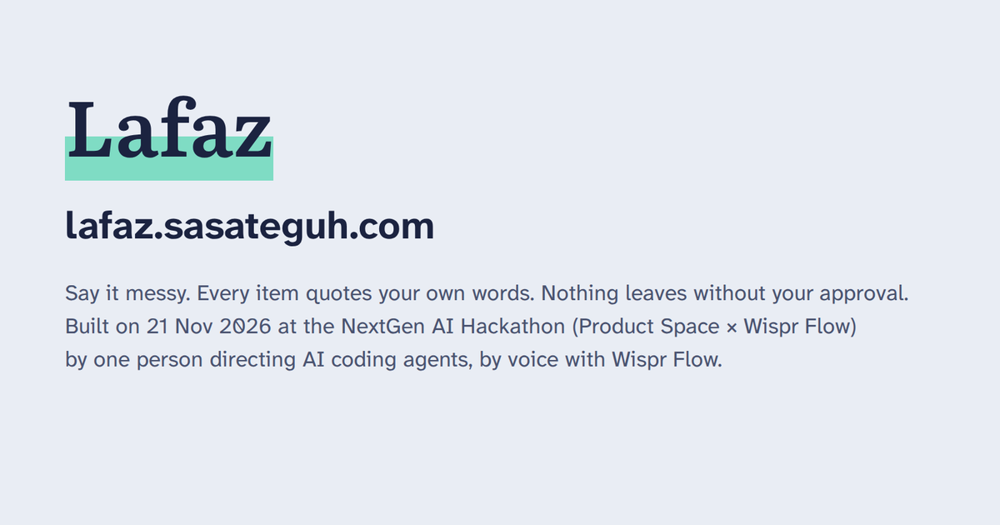
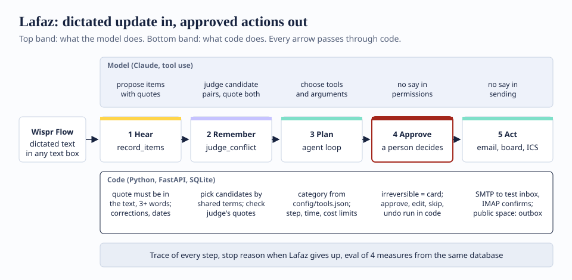

# Lafaz

**Say it messy. Every item quotes your own words. Nothing leaves without your approval.**

Built on 21 Nov 2026 at the Agentic AI Hackathon by Product Space x Wispr Flow.
Problem statement: meeting to execution.

- Live: https://lafaz.sasateguh.com
- Video (1.5 min): https://youtu.be/PpIyKNEM7_s
- How it is measured: https://lafaz.sasateguh.com/eval and [docs/MEASURED.md](docs/MEASURED.md)



## The problem

After a meeting or a site visit, the update is spoken in a hurry: half sentences, a date said as "next Friday", a name
changed halfway. Someone then has to turn that into tasks, emails and reminders. An assistant that does this alone can send
the wrong thing to the wrong person, and nobody can see why.

## What Lafaz does

1. **Heard.** You dictate the update with Wispr Flow, filler words and corrections included. Lafaz shows what it heard and
   marks each decision, action, question and fact on your own words. When you correct yourself ("Tuesday, no wait,
   Wednesday"), the newer words win and the old ones are struck through.
2. **Understood.** Every item carries an owner, a due date and the exact quote that proves it. Code checks that each quote
   really appears in what you said; an item without proof is rejected.
3. **Plan.** Lafaz drafts the follow-ups: emails, reminders, team board posts, calendar entries.
4. **Approve.** Anything that leaves the room waits on a card until a person presses Approve. When Lafaz cannot finish, it
   stops and says where and why.

Other pages: `/board` (team board, only approved tasks), `/memory` (decisions and what replaced them), `/voice`,
`/about`. Interface in English and Malay.

## How it is measured

24 fixed tasks run through the same agent loop as the live page, with nobody approving anything
([docs/MEASURED.md](docs/MEASURED.md), commit `46f110d`, model `claude-sonnet-5-5`):

| Measure | Result |
|---|---|
| Task success | 24 of 24 |
| Path quality | 1.77x the minimum tool steps, 0 repeated calls |
| Constraint adherence | 0 irreversible actions without approval (37 left waiting for a person) |
| Give-up quality | 2 of 2 on the 4 tasks meant to stop |

Mean cost USD 0.0217 per run; p50 latency 8.7 s.

## How it is built

One Python process (FastAPI + HTMX) with SQLite in WAL mode. Which tools are reversible and which need approval comes from
one config file (`config/tools.json`); the agent loop reads it, no code decides it. Details:
[docs/ARCHITECTURE.md](docs/ARCHITECTURE.md), decisions in [docs/DECISIONS.md](docs/DECISIONS.md).



## Run it locally

```bash
docker build -t lafaz .
docker run --rm -p 8080:8080 -e ANTHROPIC_API_KEY=sk-ant-... lafaz
# open http://localhost:8080
```

Tests: `scripts/uji.sh` (creates `.venv` with uv, then runs pytest). Evals: `python -m lafaz.eval`.

## Wispr Flow

Wispr Flow is the input: you dictate into the update box and Lafaz works from what Flow typed. The video shows real Wispr
Flow screenshots from this build, including a self-correction that Flow cleaned up before Lafaz read it.

## My contribution and the AI's

All code was written during the event by AI coding agents (Claude) that I directed. I chose the problem, set the rules the
agent must never break, and approved what shipped. Before the event I wrote a plan for approaching any agent brief; no code.

## Limitations

- Speech reaches Lafaz as text typed by Wispr Flow; there is no audio input of its own.
- Public visitors work in a sandbox: email delivery runs only in the owner's space.
- Evaluated on 24 tasks written for this build, not on real customer meetings.

## License

MIT
